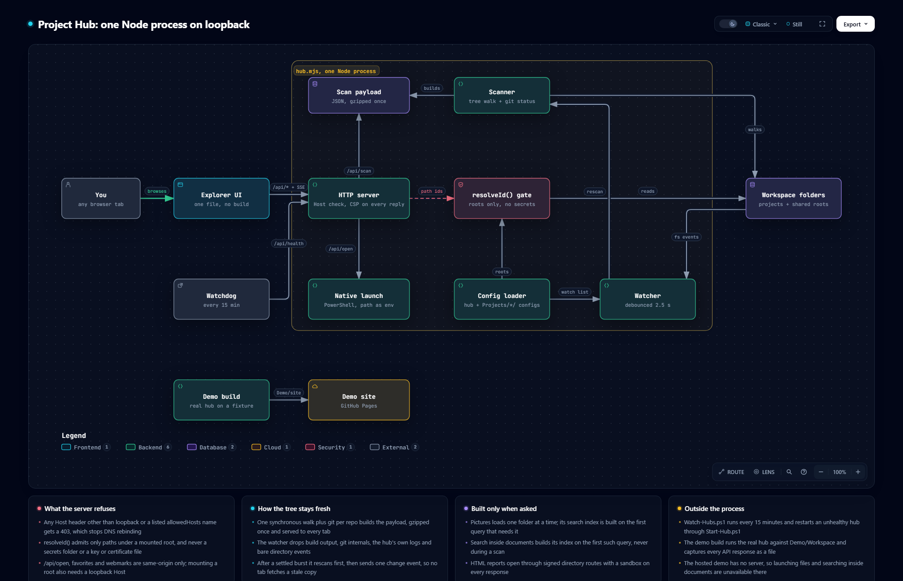

<h1 align="center">🧭 Diagrams</h1>

<p align="center">
  <em>How Project Hub's one Node process is put together, drawn from the code and checked against it.</em>
</p>

<p align="center">
  
  
  <a href="../README.md"></a>
</p>

---

## 🏗️ Hub architecture

[](hub-architecture.html)

What sits behind the page: the explorer UI (`Hub/index.html`) calls one HTTP server on
`127.0.0.1:4273` that refuses any Host header but loopback or a listed `allowedHosts` name and
sets a CSP on every reply. The server hands every tab the same cached scan payload, which the
scanner builds by walking the workspace folders and reading git state. Anything addressed by path
goes through the `resolveId()` gate, which admits only mounted roots and never a secrets folder or
key file; `/api/open` launches a file through PowerShell with the path passed as data. The config
loader sets the roots the gate serves and the folders the watcher follows, and a settled burst of
file events triggers a rescan before the page is told. Outside the process, `Watch-Hubs.ps1`
checks `/api/health` every 15 minutes, and the demo build runs the real hub on a fixture to publish
the static demo. Below the map, four cards cover what the server refuses, how the tree stays fresh,
what is built only when asked, and what runs outside the process.

**See it on the [homepage](https://project-hub.ai-automation-tools.dev/#architecture)**, or open the interactive version: [`hub-architecture.html`](hub-architecture.html) in a browser
from a clone, or [render it from GitHub](https://raw.githack.com/ai-automation-tools/project-hub/main/Docs/diagrams/hub-architecture.html).
Each component links to the exact lines it describes at the pinned commit, and the viewer adds route
tracing, search, light/dark, and SVG/PNG export.

## 📂 Files

| File | What it is | Edit it? |
|:---|:---|:---|
| [`hub-architecture.json`](hub-architecture.json) | The source: components, connections, the boundary, cards, and the code each component cites | **Yes, this is the only file you edit** |
| `hub-architecture.html` · `.png` | Generated: the interactive diagram, which the homepage embeds live, and a static PNG snapshot | Never; rebuild |
| `project-hub-site/hub-architecture.html` · `.png` | Copies the build writes into the homepage repo, a separate private repo whose root Pages publishes. `--check` flags a copy that differs | Never; rebuild |
| `hub-architecture.delivery.json` · `.sources.lock.json` | Build receipt, and the git blob of every cited file at the pinned commit | Never; rebuild |
| [`../../scripts/build-diagram.mjs`](../../scripts/build-diagram.mjs) | Builds the diagram and checks it for drift | Only to change how it builds or checks |

## 🔁 Keeping it current

Every component cites code by path and line range, pinned to the commit in `meta.repository.revision`.
The cited files are `Hub/hub.mjs`, `Hub/index.html`, `Hub/open-native.mjs`, `Hub/Watch-Hubs.ps1`,
`Demo/build-demo.mjs` and `.github/workflows/demo.yml`. `hub.mjs` and `index.html` change often,
so expect the check to name them; each time, the diagram may describe logic that moved or no
longer exists, and it counts as stale until someone has re-read that code.

| When | What catches it |
|:---|:---|
| **Every push and PR** | CI's *Diagram drift* step runs `--hook --no-site` and turns each finding into a warning annotation. It never fails the build |
| **Any time** | `node scripts/build-diagram.mjs --check` exits 1 and names the stale files |
| **Weekly** | The repo owner's doc drift check runs `--check` on the local clone, and the org upkeep job rebuilds a stale diagram by PR |

The homepage lives in its own repo, so the builder needs a clone of it. By default that is
`../project-hub-site`, next to this one; pass `--site <path>` for another place, or `--no-site`
to skip the copies (CI does, since it has no clone). Without either, a missing clone is an `ISSUE`
in `--check` and a failed build.

To bring it up to date:

1. Commit the code change first. Evidence is pinned to committed bytes, never to working-tree edits.
2. Re-read each changed file the check named. In `hub-architecture.json`, fix the line ranges in
   `sources` (at most three per component), and any label, sublabel, connection or card the change
   made untrue. A new subsystem or outside process gets a component in the row of its neighbours;
   a removed one goes. Keep the existing ids.
3. Rebuild, re-pinning to the commit you just read:

   ```sh
   node scripts/build-diagram.mjs --pin-head
   ```

4. Commit the JSON and the generated files here with a [CHANGELOG](../CHANGELOG.md) line, and the two
   copies in `project-hub-site` there.

Building needs Node 18+, Chrome, and the [Archify](https://github.com/tt-a1i/archify) skill
(default path `~/.claude/skills/archify/bin/archify.mjs`; pass `--archify <path>` to point
elsewhere). The check needs only git. A failed build exits 1 and leaves the last good HTML and
PNG in place; the reason is in `Docs/diagrams/.build/hub-architecture.finalize-summary.json`.

---

<p align="center">
  <sub>← <a href="../README.md">Documentation home</a> · <a href="../../README.md">Project Hub</a></sub>
</p>
