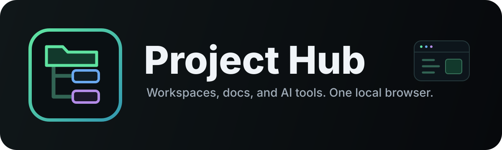
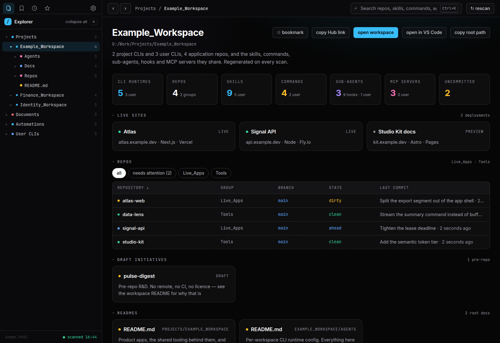
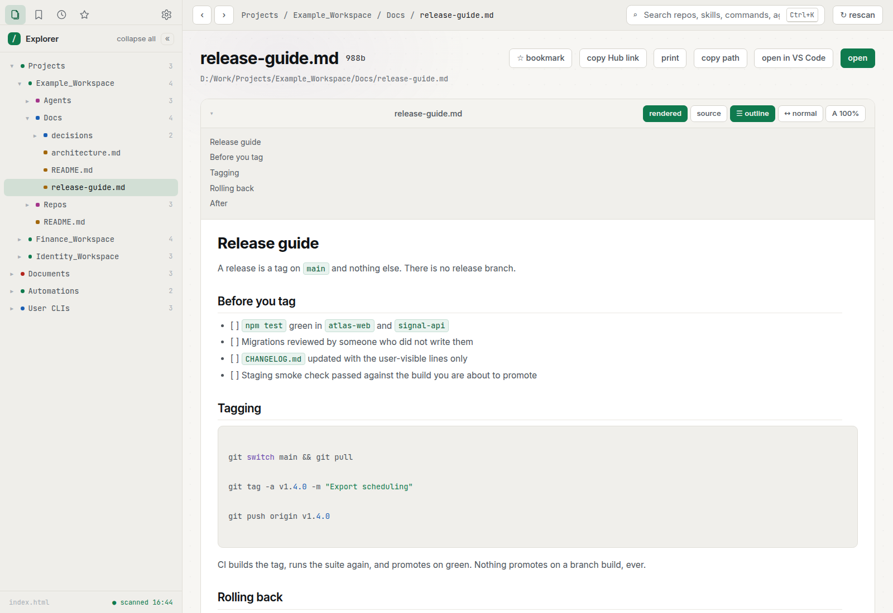

<a id="readme-top"></a>
<a id="html-design-top"></a>

<p align="center">
  <a href="docs/README.md">
    
  </a>
</p>

<p align="center">
  <em>Your workspaces, docs, and AI tools<br>in one local browser.</em>
</p>

<p align="center">
  <a href="docs/README.md"><strong>Explore the docs »</strong></a>
</p>

<p align="center">
  <a href="https://project-hub.ai-automation-tools.dev">Homepage</a> ·
  <a href="https://project-hub-demo.ai-automation-tools.dev">Live demo</a> ·
  <a href="#-screenshots">Screenshots</a> ·
  <a href="#-setup">Quick start</a> ·
  <a href="skills/project-hub-scaffold/SKILL.md">Scaffold skill</a>
</p>

<p align="center">
  <a href="https://project-hub-demo.ai-automation-tools.dev"></a>
  <a href="project-hub/README.md"></a>
  <a href="LICENSE"></a>
  <a href="docs/ROADMAP.md"></a>
  <a href="https://github.com/ai-automation-tools"></a>
</p>

<p align="center">
  
  
  
</p>

---

**Project Hub** scans your workspaces and displays their repos, Git status, documents,
and AI agent tools in one browser interface. Browse files, search, bookmark pages,
and preview Markdown, PDFs, HTML reports, and images. The view updates as files change.
A VS Code-style activity bar switches the sidebar between the file explorer, your
bookmarks, recent documents, favorite websites and settings. Favorites are the hub's own
list, imported from any browser or synced live with Edge, Chrome or Brave, and websites can
open in tabs inside the hub.

One local server handles all your workspaces. No build step or runtime dependencies.

## 🌐 Try it

**[project-hub-demo.ai-automation-tools.dev](https://project-hub-demo.ai-automation-tools.dev)** — a
hosted, read-only hub over a fictional workspace. It is the real interface and the real
scan output, captured from an actual hub run against fixture content, so what you click
through is what the tool does. Live updates and file-opening need the local server, and
the demo says so where you reach them. [How it is built](demo/README.md).

## 📸 Screenshots

Sample workspaces with fictional content. Click an image for the full view.

[](images/Public/project-overview.png)

<details>
<summary><strong>📖 Document reader · paper theme</strong></summary>

[](images/Public/document-reader.png)

</details>

## 🔧 Setup

Requires Node 18.17+ and Git on PATH. Windows launchers also need PowerShell 7 (`pwsh`).

From the repository root, copy the example configs:

```powershell
Copy-Item project-hub/hub.config.example.json project-hub/hub.config.json
New-Item -ItemType Directory projects/My_Workspace
Copy-Item projects/_example/hub.config.json.example projects/My_Workspace/hub.config.json
```

Edit the copies before starting:

- **Server config:** set `base` to your workspace base folder and `sharedRoots` to any shared document or picture folders.
- **Workspace config:** set `name` and `dir` for your workspace. Adjust or remove `repoScope` to choose which repos appear.

Real configs stay out of Git. See the [config reference](hub/README.md#the-config) for details.

## 🚀 Run the hub

From the repository root:

```powershell
./project-hub/Start-Hub.ps1
```

Or start Node directly:

```sh
node hub/hub.mjs --config project-hub/hub.config.json
```

Open `http://127.0.0.1:4273`, or the port you configured. Native file-opening actions
are Windows-specific.

To add a workspace, create another `projects/<Name>/hub.config.json` and restart the
server. Run tests with `npm test` from `hub/`; once you have copied the configs, they also
check that each workspace `dir` exists.

## 📂 Explore the project

| Location | Contents |
|:---|:---|
| [**⚙️ Hub**](hub/README.md) | Server, scanner, interface, and tests |
| [**🚀 Project-Hub**](project-hub/README.md) | Launcher, configuration, and user manual |
| [**📁 Projects**](projects/_example/hub.config.json.example) | Example workspace config |
| [**📚 Docs**](docs/README.md) | Guides, roadmap, and design research |
| [**🧭 Diagrams**](docs/diagrams/README.md) | The architecture shown on the [homepage](https://project-hub.ai-automation-tools.dev/#architecture), interactive and linked to the code, plus how it stays in step with it |
| [**🌐 Demo**](demo/README.md) | Fixture workspace and the build behind the hosted demo |
| [**🧩 Scaffold skill**](skills/project-hub-scaffold/SKILL.md) | Add workspaces or create a portable installation |
| [**🖼️ Images**](images/README.md) | Public screenshots and local design references |
| [**🎨 Src**](src/README.md) | Notes about the original design exports |

To use the scaffold skill, copy its whole folder into your agent's skills directory
and provide the path to this checkout.

### 🧠 Skills for working on this repo

Three agent skills cover the hub's own internals. They live in
[**agent-skills**](https://github.com/ai-automation-tools/agent-skills/tree/main/skills/projects/project-hub),
which is canonical for them. They are installed as an overlay into this clone's `.claude/skills/`,
and that installed copy is committed here, next to [`CLAUDE.md`](CLAUDE.md) and a small
`.claude/` setup: a `hub-reviewer` agent and a `/check` command to run before committing.

| Skill | Covers |
|:---|:---|
| [`project-hub-scan`](https://github.com/ai-automation-tools/agent-skills/blob/main/skills/projects/project-hub/project-hub-scan/SKILL.md) | `hub/hub.mjs` — the scan filter chain, node kinds, the agent-runtime tables, the `resolveId()` deny gate, caching and the watcher |
| [`project-hub-client`](https://github.com/ai-automation-tools/agent-skills/blob/main/skills/projects/project-hub/project-hub-client/SKILL.md) | `hub/index.html` — the view dispatch, the eight colour schemes, state and routes, the CSP nonce contract |
| [`project-hub-demo`](https://github.com/ai-automation-tools/agent-skills/blob/main/skills/projects/project-hub/project-hub-demo/SKILL.md) | `demo/build-demo.mjs` — the fixture, the capture, the literal assertions against `index.html`, and the Pages deploy |

```powershell
pwsh scripts/install-skills.ps1 -Project project-hub -Destination <this-clone>/.claude/skills
```

Run that from an `agent-skills` checkout to refresh the committed copy after the skills change
there, and commit the result. Don't edit the copies here.

## 🔒 Privacy and publishing

The server runs on loopback for local use. Configs, scans, logs, and private design
assets are ignored. Browser fonts and images linked in documents may make external requests.
Browser favorites sync, when switched on, reads the Edge, Chrome or Brave profile files on this computer. To draw favicons and to decide whether a site can open in a hub tab, the **server** requests those sites' pages and icons directly, and never through a third-party favicon service. Manual favorites are saved in `favorites.json` beside the server config, which is gitignored.

The published files carry no personal paths, hostnames or credentials — every example uses
generic placeholders. **The commit history is a different question**, and one worth stating
plainly rather than leaving to be discovered: earlier commits predate that cleanup and were
never rewritten. See [public release notes](docs/PUBLIC-RELEASE.md) for what that covers and
what it does not.

## 🔗 Related repositories

Part of the [**ai-automation-tools**](https://github.com/ai-automation-tools) organization.

| Repo | How it relates |
|:---|:---|
| [**agent-skills**](https://github.com/ai-automation-tools/agent-skills) | **The canonical home of the scaffold skill** bundled here at [`skills/project-hub-scaffold/`](skills/project-hub-scaffold/SKILL.md). The copy in this repo is a travel copy so the skill works without that repo present, byte for byte the canonical one. A change belongs there first. It also carries three **maintainer skills for this codebase** — see below. |
| [**Roundtable**](https://github.com/ai-automation-tools/roundtable) | MCP server for AI-to-AI conversations. Its workspace is one of the things a hub renders. |
| [**cronsole**](https://github.com/ai-automation-tools/cronsole) | Scheduled-task control plane. The hub's watchdog is one of the tasks it can see. |

---

<p align="center">
  Built with Node.js and vanilla JavaScript · <a href="LICENSE">MIT license</a><br>
  <a href="project-hub/README.md">User manual</a> ·
  <a href="skills/project-hub-scaffold/SKILL.md">Scaffold skill</a> ·
  <a href="docs/ROADMAP.md">Roadmap</a>
</p>

<p align="right"><sub><a href="#readme-top">back to top</a></sub></p>
